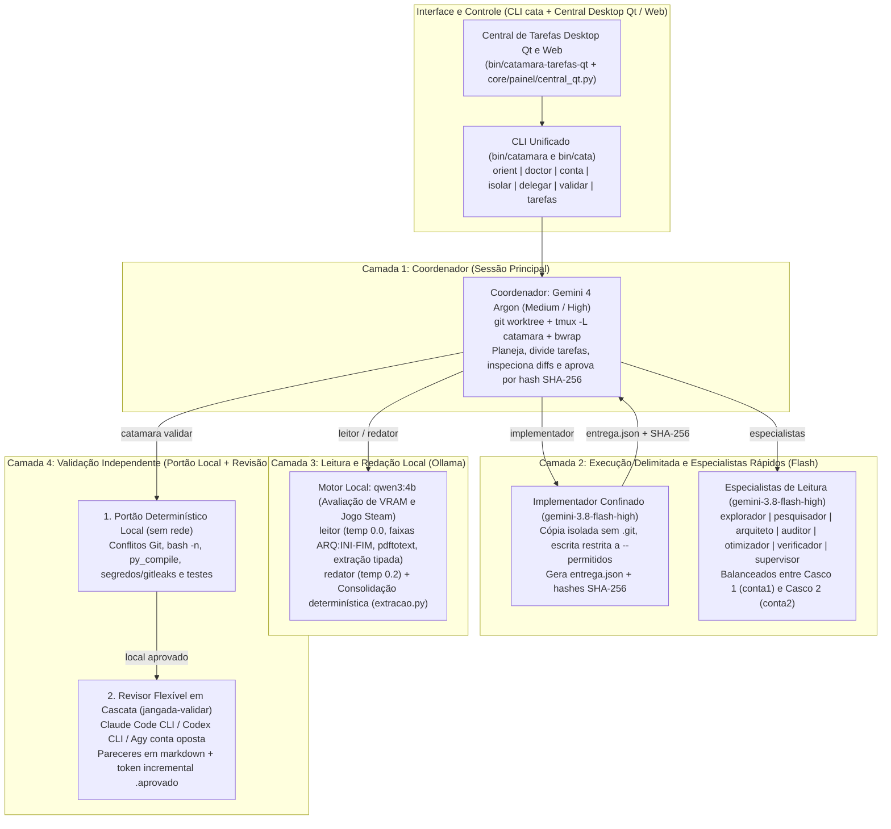
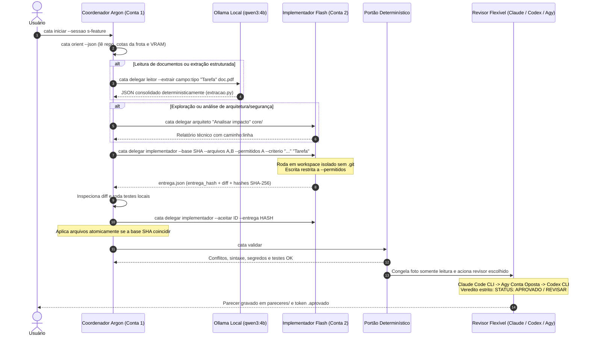
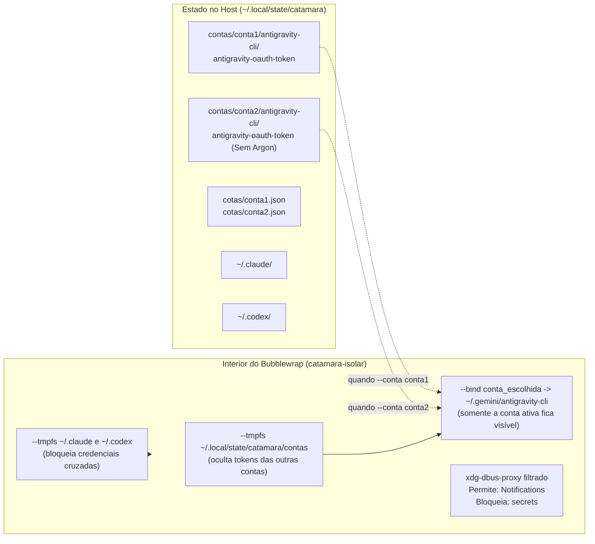

# Catamarã (`catamara` / `cata`)

```text
                |                  JANGADA · CATAMARÃ
                |\                 Frota Multiagente N-Cascos
                | \                Coordenador Argon + Executor Flash + Revisor Flexível + Motor Local
                |  \               
                | (*) \            • Casco 1 (conta1): Sessão Principal / Coordenador (Argon ativo)
                |      \           • Casco 2 (conta2): Execução Paralela / Especialistas (Sem Argon)
                |_______\          • Frota N-Cascos:   Claude Code, Codex CLI, Agy isolado e Ollama
     ___________|____________      
     \==|==|==|==|==|==|==|=/      
   ~~~~  ~~~~~~   ~~~~~~  ~~~~     
```

O **Catamarã** é uma aplicação multiagente enxuta e independente da família `jangada`, construída para orquestrar uma frota flexível de N cascos heterogêneos (Antigravity CLI com N contas isoladas, Claude Code CLI, Codex CLI e motor local Ollama). A arquitetura opera sob confinamento estrito do kernel (`bubblewrap`), controle determinístico de integridade por hash SHA-256 e interface visual inspirada nos conceitos do `ai-toolkit-web` (AI Usage Bar, AI Jail e AI Memory).

---

## 1. As 4 Camadas da Arquitetura

O software distribui a carga de trabalho em quatro camadas especializadas para preservar a cota semanal do modelo mais forte (`Gemini 4 Argon`), acelerar tarefas delimitadas com `Gemini 3.8 Flash`, manter dados sensíveis no `Ollama` local e permitir revisão independente com múltiplos provedores (`Claude`, `Codex` ou conta oposta do `Agy`):



---

## 2. Conceitos do AI-Toolkit-Web Incorporados

Inspirado nas soluções de observabilidade e segurança do `ai-toolkit-web` (Akita on Rails), o Catamarã adota três pilares arquiteturais:

1. **AI Usage Bar (Indicadores em Tempo Real):**
   - Telemetria de cotas para toda a frota (Claude, Codex, Agy 1..N e Ollama).
   - **Fidelidade estrita de cotas:** o Casco 2 não possui o balde semanal de Argon (`gemini-argon-wtu-weekly`). O sistema identifica essa ausência com precisão, marcando `tem_argon: false`, zerando a exibição de cota falsa e exibindo o badge visual `[Sem Argon]`.

2. **AI Jail (Confinamento Estrito e Telemetria):**
   - Isolamento via `bubblewrap` com mascaramento recíproco de credenciais (`bin/catamara-isolar`). Ao rodar tarefas do Agy, credenciais de Claude (`~/.claude`) e Codex (`~/.codex`) são ocultadas via tmpfs, além de limpar variáveis de ambiente cruzadas (`ANTHROPIC_*`, `OPENAI_*`).
   - Telemetria de processos confinados gravada em `$CATAMARA_ESTADO/processos/` para auditoria em tempo real.

3. **AI Memory e Gestão de Entregas:**
   - Inspeção de diffs na interface Qt com realce de sintaxe em tipografia `JetBrains Mono`.
   - Aceite atômico de alterações com conferência de hash SHA-256, garantindo que nada seja aplicado ao código sem auditoria prévia.

---

## 3. Ciclo de Vida Completo de uma Tarefa

O diagrama abaixo mostra o percurso de uma tarefa desde a abertura da sessão até a aprovação final na validação cruzada:



---

## 4. Isolamento Multi-Conta, Multi-Provedor e Frota de Cascos

O `catamara-isolar` impede que processos acessem tokens indevidos ou credenciais de outros provedores:



### Frota de Cascos e Regras de Roteamento (`core/contas/contas.py`)

| Casco / Provedor | Identificador | Capacidades e Papéis | Política de Cota e Fallback |
|---|---|---|---|
| **Agy Casco 1** | `conta1` | Coordenador (`autor`), Especialistas | Possui Argon semanal ativo (`tem_argon: true`). Usado prioritariamente para coordenação. |
| **Agy Casco 2** | `conta2` | Executor Flash (`executor`), Especialistas | Sem Argon (`tem_argon: false`, cota 0%). Não aceita papéis de Argon. Balanceia tarefas Flash. |
| **Claude Code** | `claude` | Revisor (`revisor`), Análise Profunda | Invoca CLI Claude oficial sob isolamento. Usado na primeira linha de revisão independente. |
| **Codex CLI** | `codex` | Revisor alternativo, Implementador | CLI de apoio em cascata para tarefas de código e validação secundária. |
| **Ollama Local** | `local` | Leitor (`leitor`), Redator (`redator`) | Modelo `qwen3:4b`. Exige VRAM >= 4000 MiB e ausência de jogos Steam. Trava via `flock`. |

---

## 5. Estrutura do Repositório

```text
catamara/
├── bin/
│   ├── catamara               CLI principal unificado
│   ├── cata                   Atalho curto para bin/catamara
│   ├── catamara-config        Variáveis XDG, modelos padrão, travas flock e git seguro
│   ├── catamara-isolar        Sandbox bubblewrap com isolamento multi-provedor e telemetria
│   ├── catamara-delegar       Roteador para Ollama local, especialistas Flash e implementador
│   ├── catamara-validar       Validador flexível estilo jangada-validar (Claude, Codex, Agy)
│   ├── catamara-hook-leitor   Filtro PreToolUse estrito para comandos de leitura
│   ├── catamara-tarefas       Central de Tarefas CLI, TUI, Web e Waybar
│   └── catamara-tarefas-qt    Central Desktop nativa PyQt6 com AI Usage Bar e AI Memory
├── core/
│   ├── contas/
│   │   └── contas.py          Frota N-cascos, catálogo, fidelidade Argon e fallback
│   ├── delegacao/
│   │   ├── avaliar_ollama.py  Checagem de VRAM/Steam e execução local no qwen3:4b
│   │   ├── extracao.py        Esquema tipado e consolidação determinística de fatias
│   │   └── implementacao.py   Preparação, montagem bwrap, finalização e aceite por SHA-256
│   ├── orquestracao/
│   │   ├── orient.py          Fotografia rápida do repositório, sessão, contas e Ollama
│   │   ├── doctor.py          Diagnóstico de binários, isolamento bwrap e sincronização
│   │   ├── deterministico.py  Verificador offline de conflitos, sintaxe, segredos e testes
│   │   └── sessoes.py         Ciclo de vida de sessões tmux -L catamara e git worktree
│   ├── painel/
│   │   ├── servidor.py        API HTTP local (127.0.0.1) e coletor de estado da frota
│   │   ├── central.html       Interface Web oficial unificada com identidade Jangada
│   │   ├── central_qt.py      Container Desktop nativo PyQt6 (QWebEngineView + fallback)
│   │   └── catamara-symbolic.svg  Logotipo oficial preservado
│   └── agentes/
│       └── agy/
│           ├── agents/        11 especialistas (.md): explorador, leitor, pesquisador, arquiteto,
│           │                  auditor, otimizador, redator, verificador, supervisor, implementador, revisor
│           └── hooks.json     Configuração do filtro PreToolUse
└── testes/
    └── verificar.sh           Suíte determinística completa com checagem de regras e integridade
```

---

## 6. Comandos Principais

```bash
# 1. Listar catálogo da frota de cascos e status de contas
./bin/cata conta cascos
./bin/cata conta status

# 2. Inicializar contas Agy e efetuar login do Casco 2
./bin/cata conta init --importar-atual
./bin/cata conta login conta2

# 3. Diagnóstico de integridade e orientação da sessão
./bin/cata doctor
./bin/cata orient

# 4. Central de Tarefas Unificada (Desktop PyQt6, Navegador Web e Terminal TUI)
./bin/cata tarefas --qt       # Janela desktop nativa unificada (QWebEngineView com central.html)
./bin/cata tarefas-qt         # Atalho direto para a janela desktop
./bin/cata tarefas --web      # Abre a interface gráfica diretamente no navegador padrão
./bin/cata tarefas --status   # Modo TUI renderizado em ASCII art no terminal
./bin/cata tarefas --qt --nativa  # Modo legado com widgets nativos QWidget (sem WebEngine)

# 5. Delegar leitura local (Ollama) ou análise por especialistas
./bin/cata delegar leitor --extrair autor:texto "Extrair metadados" artigo.pdf
./bin/cata delegar arquiteto "Avaliar acoplamento de módulos" core/

# 6. Implementação confinada e aceite por hash SHA-256
./bin/cata delegar implementador \
  --base "$(git rev-parse HEAD)" \
  --arquivos core/contas/contas.py \
  --permitidos core/contas/contas.py \
  --criterio "python3 -m py_compile core/contas/contas.py" \
  "Adicionar catálogo da frota de cascos"
./bin/cata delegar implementador --aceitar <ID> --entrega <HASH>

# 7. Validação flexível estilo jangada-validar
./bin/cata validar --revisor claude
./bin/cata validar --revisor oposto
./bin/cata validar --so-deterministico

# 8. Executar suíte de testes do projeto
./testes/verificar.sh
```
