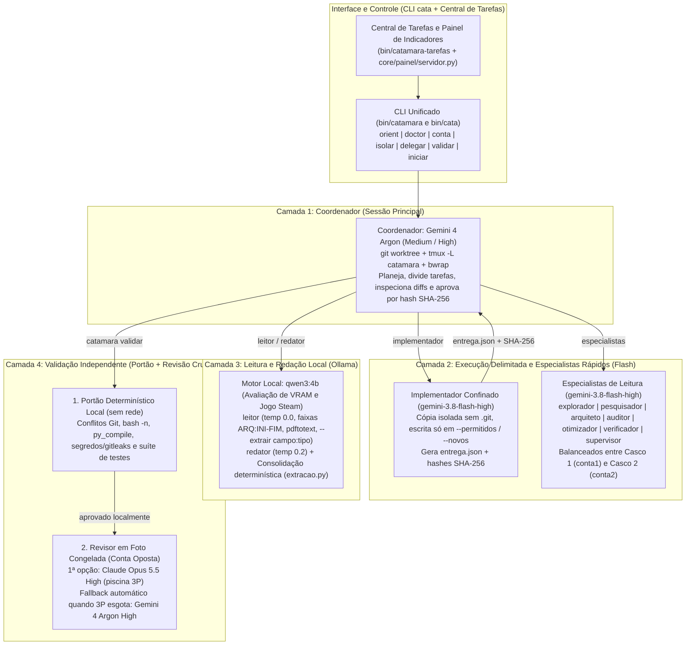
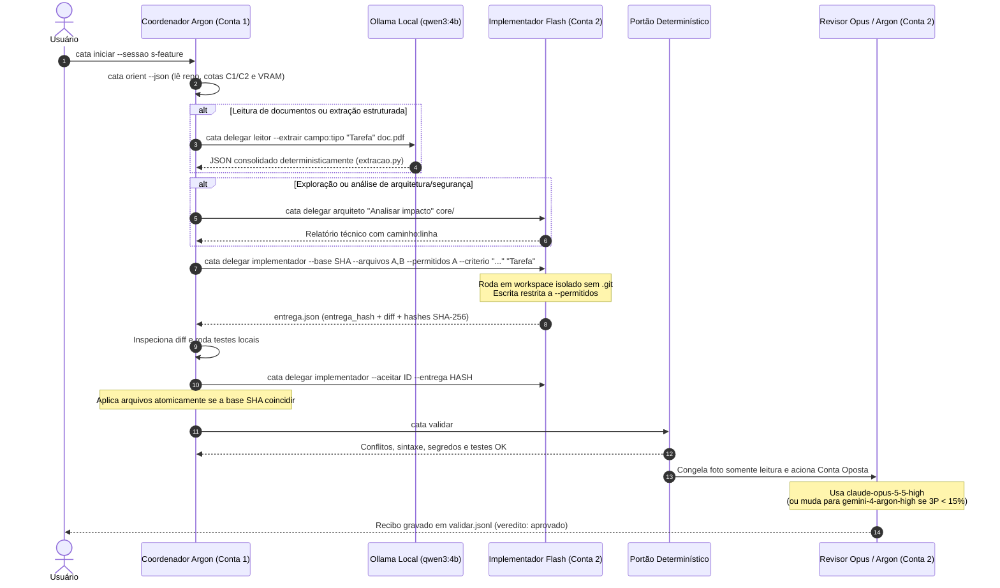
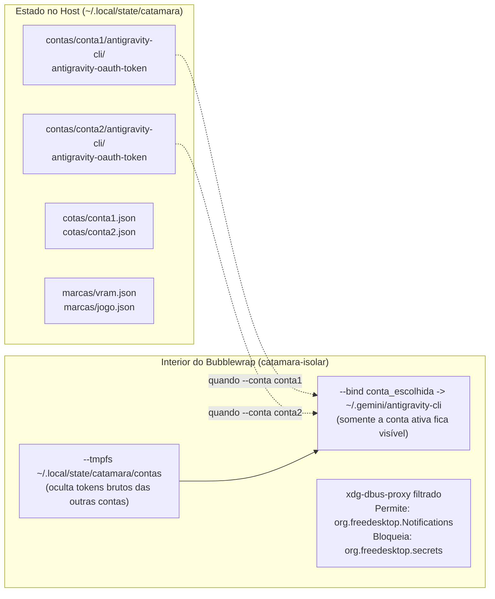

# Catamarã (`catamara` / `cata`)

```text
                |                  JANGADA · CATAMARÃ
                |\                 Arquitetura Multiagente de Casco Duplo
                | \                Coordenador Argon + Executor Flash + Revisor Opus + Motor Local Ollama
                |  \               
                | (*) \            • Casco 1 (conta1): Sessão Principal / Coordenador
                |      \           • Casco 2 (conta2): Execução Paralela / Revisão Cruzada
                |_______\          • Motor Local:      Ollama (qwen3:4b) sob trava exclusiva
     ___________|____________      
     \==|==|==|==|==|==|==|=/      
   ~~~~  ~~~~~~   ~~~~~~  ~~~~     
```

O **Catamarã** é uma aplicação multiagente enxuta e independente da família `jangada`, construída para operar duas contas do Antigravity CLI (`agy`) em paralelo (`conta1` e `conta2`), combinadas ao `Ollama` local (`qwen3:4b`), sob confinamento estrito do kernel (`bubblewrap`) e controle determinístico de entregas por hash SHA-256.

---

## 1. As 4 Camadas da Arquitetura

O software divide o trabalho em quatro camadas especializadas para preservar a cota semanal do modelo mais forte (`Gemini 4 Argon`), acelerar tarefas delimitadas com `Gemini 3.8 Flash`, manter documentos sensíveis no `Ollama` local e garantir revisão independente em outra família de modelo (`Claude Opus 5.5`, com fallback automático para `Argon`):



---

## 2. Ciclo de Vida Completo de uma Tarefa

O diagrama abaixo mostra o percurso de uma tarefa desde a abertura da sessão até a aprovação final na validação cruzada:



---

## 3. Isolamento Multi-Conta (`bubblewrap`) e Cascata de Modelos

O `agy` tenta primeiro ler credenciais do chaveiro D-Bus (`org.freedesktop.secrets`) e, quando este não está presente, utiliza o arquivo `~/.gemini/antigravity-cli/antigravity-oauth-token` (`cliFileTokenStorage`).

O `catamara-isolar` explora esse comportamento de forma determinística para impedir que uma conta sobrescreva o login da outra:



### Regras de Seleção de Conta e Fallback de Cota (`core/contas/contas.py`)

| Papel | Modelo Principal | Piscina de Cota Consultada | Regra de Escolha e Fallback |
|---|---|---|---|
| **Coordenador (`autor`)** | `gemini-4-argon-medium` / `high` | `gemini-argon-wtu-weekly`, `gemini-5h`, `gemini-weekly` | Escolhe a conta autenticada com maior saldo de Argon. |
| **Executor / Especialistas (`executor`)** | `gemini-3.8-flash-high` | `gemini-5h`, `gemini-weekly` | Balanceia entre `conta1` e `conta2` pela maior cota Flash disponível. |
| **Leitor / Redator (`local`)** | `qwen3:4b` (Ollama) | VRAM local (`>= 4000 MiB`) e ausência de jogo Steam | Roda localmente sob `flock` (`local.lock`); se indisponível, faz fallback para `gemini-3.8-flash-high`. |
| **Revisor (`revisor`)** | `claude-opus-5-5-high` | `3p-5h`, `3p-weekly` | Exige a **conta oposta** à do autor (`--evitar CONTA_AUTOR`). Quando a cota `3p` do Opus cai abaixo de 15% (ou retorna limite esgotado), muda automaticamente para **`gemini-4-argon-high`**. |

---

## 4. Estrutura do Repositório

```text
catamara/
├── bin/
│   ├── catamara               CLI principal unificado
│   ├── cata                   Atalho curto para bin/catamara
│   ├── catamara-config        Variáveis XDG, modelos padrão, travas flock e git seguro
│   ├── catamara-isolar        Sandbox bubblewrap multi-conta sem org.freedesktop.secrets
│   ├── catamara-delegar       Roteador para Ollama local, especialistas Flash e implementador
│   ├── catamara-validar       Portão determinístico offline + revisor na conta oposta
│   ├── catamara-hook-leitor   Filtro PreToolUse estrito para comandos de leitura
│   └── catamara-tarefas       Central de Tarefas e Painel de Indicadores (TUI, Web e Waybar)
├── core/
│   ├── contas/
│   │   └── contas.py          Gerenciador multi-conta, trustedWorkspaces, cotas /usage e fallback
│   ├── delegacao/
│   │   ├── avaliar_ollama.py  Checagem de VRAM/Steam e execução local no qwen3:4b
│   │   ├── extracao.py        Esquema tipado e consolidação determinística de fatias
│   │   └── implementacao.py   Preparação, montagem bwrap, finalização e aceite por SHA-256
│   ├── orquestracao/
│   │   ├── orient.py          Fotografia rápida do repositório, sessão, contas e Ollama
│   │   ├── doctor.py          Diagnóstico de binários, isolamento bwrap e sincronização
│   │   ├── deterministico.py  Verificador offline de conflitos, sintaxe, segredos e testes
│   │   └── sessoes.py         Ciclo de vida de sessões tmux -L catamara e git worktree
│   ├── painel/
│   │   ├── servidor.py        API HTTP local (127.0.0.1) e coletor de estado e indicadores
│   │   └── central.html       Interface visual com a identidade oficial da Jangada
│   └── agentes/
│       └── agy/
│           ├── agents/        11 especialistas (.md): explorador, leitor, pesquisador, arquiteto,
│           │                  auditor, otimizador, redator, verificador, supervisor, implementador, revisor
│           └── hooks.json     Configuração do filtro PreToolUse
└── testes/
    └── verificar.sh           Suíte determinística completa (Fases 1, 2, 3 e Painel)
```

---

## 5. Comandos Principais

```bash
# 1. Inicializar as duas contas (importando a credencial atual para conta1) e autenticar conta2
./bin/cata conta init --importar-atual
./bin/cata conta login conta2

# 2. Verificar saúde do ambiente e orientação contextual
./bin/cata doctor
./bin/cata orient

# 3. Abrir a Central de Tarefas e o Painel de Indicadores (no terminal ou no navegador)
./bin/cata tarefas --status
./bin/cata tarefas --indicadores
./bin/cata tarefas --web

# 4. Delegar leitura local (Ollama qwen3:4b) ou especialistas rápidos (Flash High)
./bin/cata delegar leitor --extrair autor:texto --extrair ano:int "Extrair referências" artigo.pdf
./bin/cata delegar arquiteto "Avaliar acoplamento entre módulos" core/

# 5. Executar implementação delimitada (Flash High) e aprovar por hash SHA-256
./bin/cata delegar implementador \
  --base "$(git rev-parse HEAD)" \
  --arquivos core/orquestracao/orient.py \
  --permitidos core/orquestracao/orient.py \
  --criterio "python3 -m py_compile core/orquestracao/orient.py" \
  "Adicionar campo de tempo de execução no resumo"
./bin/cata delegar implementador --aceitar <ID> --entrega <HASH>

# 6. Validar entrega (portão determinístico + revisor Opus/Argon na conta oposta)
./bin/cata validar

# 7. Rodar a suíte completa de verificação
./testes/verificar.sh
```
